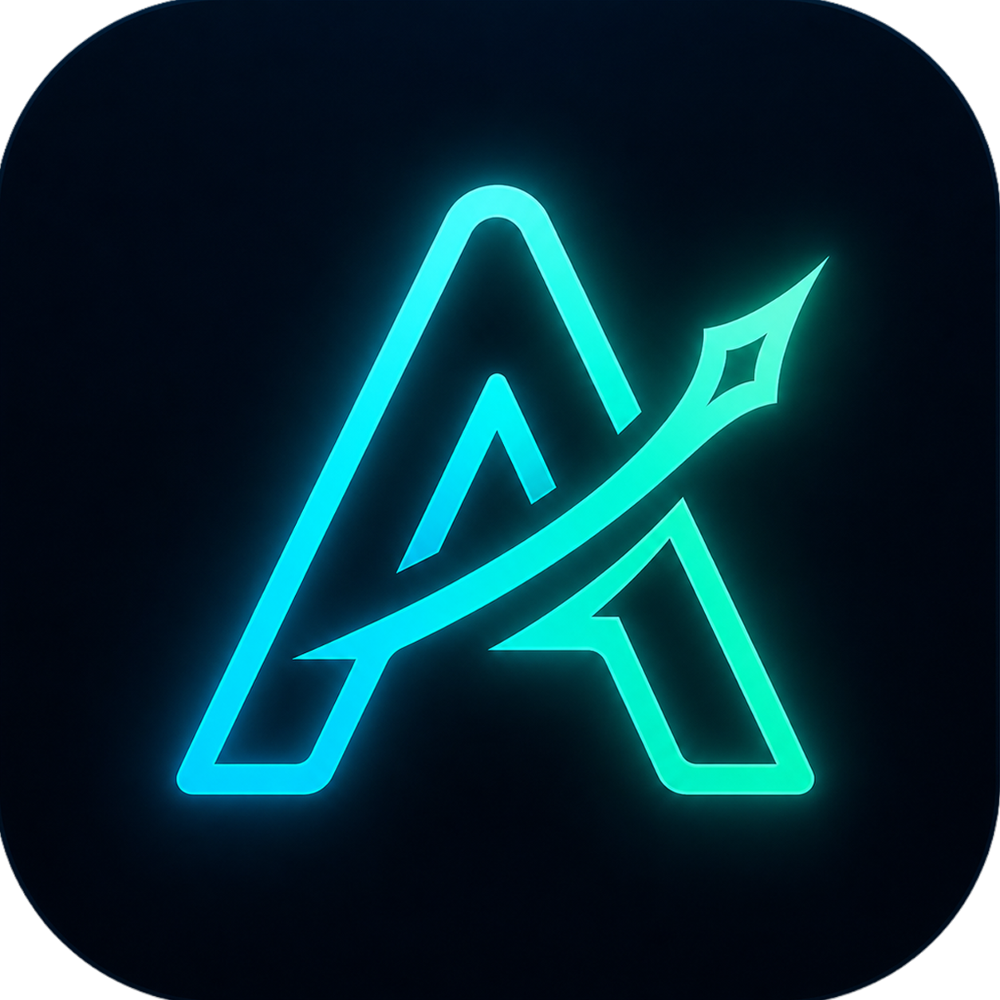

<div align="center">



# AutoLab — The Ultimate AI Editing & MCP Automation Suite for Premiere Pro

**เปลี่ยนชั่วโมงการตัดต่อให้เหลือเพียงไม่กี่นาที**
ด้วยระบบตัดต่ออัตโนมัติและ **AI Agent MCP (475+ Tools)** ที่ออกแบบมาเพื่อคนทำคอนเทนต์และทีมโปรดักชันโดยเฉพาะ

[](#)
[](../../releases/latest)
[](https://github.com/Qtpx0/autolab-premiere-skill)
[](#)
[](https://discord.com/invite/FXtK7j9E7C)

<br/>

<a href="../../releases/latest">
  
</a>
&nbsp;&nbsp;
<a href="https://github.com/Qtpx0/autolab-premiere-skill">
  
</a>

<br/><br/>

<p>
  <a href="#-ทำไมต้อง-autolab">ทำไมต้อง AutoLab?</a> &nbsp;•&nbsp;
  <a href="#-core-features">Core Features</a> &nbsp;•&nbsp;
  <a href="#-6-ai-agent--mcp-automation-suite-official-skill">AI Agent & MCP Skill</a> &nbsp;•&nbsp;
  <a href="#-installation">Installation</a> &nbsp;•&nbsp;
  <a href="#-support">Support</a>
</p>

</div>

---

## 🌟 ทำไมต้อง AutoLab?

> ปัญหาคลาสสิกของนักตัดต่อและทีมเพจคือการเสียเวลากับงานจำเจ — สร้าง Sequence, วัดสเกลใส่กรอบกราฟิก `.mogrt`, ตั้งชื่อพาดหัว 2 บรรทัด, ตัด Dead Air, ทำซับไตเติ้ล, นั่งคัดจุดไฮไลท์จากคลิปยาวๆ หรือคอยกดส่งเรนเดอร์ทีละเรื่อง

**AutoLab** คือ Extension บน Adobe Premiere Pro ที่รวบรวมเครื่องมือตัดต่ออัตโนมัติระดับโปรดักชัน พร้อมระบบเชื่อมต่อ **AI Agent ผ่าน MCP (Model Context Protocol)** ให้คุณกดทำเองในไม่กี่คลิก หรือ **สั่งงานด้วยภาษาธรรมชาติให้ AI ตัดต่อ–จัดกรอบ–ตั้งชื่อ–ส่งออก Media Encoder ให้ครบวงจรอัตโนมัติ**

> 📌 **วิธีเพิ่มเทมเพลต MOGRT ลงใน AutoLab:**


---

## 🔥 Core Features

### 🎯 1. Auto Frame & Sequence Builder (with Intelligent Auto Scale)

เครื่องมือสร้างและจัดการ Sequence อัตโนมัติแบบครบวงจร — โหลดคลิปเข้าคิว แล้วให้ AutoLab คำนวณสเกล ใส่กรอบ พาดหัว และป้ายโปรโมทให้ทันที

| ฟีเจอร์ | รายละเอียด |
|---|---|
| 🪄 **Auto Scale (Intelligent Auto-Fit)** | สแกนตรวจจับช่องใสของกรอบ `.mogrt` อัตโนมัติ พร้อมตรวจจับและตัดขอบดำซ่อนในคลิปต้นฉบับ คำนวณ Scale & Position ให้พอดีกรอบในคลิกเดียว |
| 🎬 **Line 2 Batch Subtitle & Font Size** | เพิ่มพาดหัวบรรทัดที่ 2 รายคลิป หรือกดคัดลอกใส่ทั้ง Bin ในคลิกเดียว พร้อมปุ่มปรับขนาดฟอนต์ (`+/- px`) พรีวิวสดบน Timeline |
| 🎨 **Master Profiles & Promo Replacer** | จับคู่กรอบ `.mogrt` และป้ายโปรโมทประจำรายการ/เพจ เปลี่ยนป้ายโปรโมทพร้อมภาพพรีวิวได้ทันทีทั้งแบบเดี่ยวและแบบล็อตใหญ่ |
| 📐 **Auto Resizing** | ปรับขนาดสัดส่วนให้เหมาะกับแพลตฟอร์ม (`9:16` / `1:1` / `16:9` / `4:5`) พร้อมระบบจัดวางตำแหน่งอัจฉริยะ |
| 🤖 **AI Auto-Name & 3-Layer Guard** | ตั้งชื่อพาดหัวคลิปอัตโนมัติจากเนื้อหาและเสียงพูด พร้อมระบบป้องกันรหัสคัต (`S01_`) หลุดลงไตเติ้ล และล็อกบรรทัดที่ 2 ไม่ให้สลับช่อง |
| 📦 **Turbo Batch Processing** | ประมวลผลหลายคลิปและแยกหลาย Bin พร้อมกันในครั้งเดียวด้วยความเร็วสูง |
| 🎁 **Starter Pack MOGRTs** | มีเทมเพลต MOGRT สำเร็จรูปให้ทดลองใช้งานได้ทันทีหลังติดตั้ง ไม่ต้องรอออกแบบเอง |

> 🎨 **Custom Design Service:** ต้องการ MOGRT กรอบวิดีโอหรือเทมเพลตซับไตเติ้ลแบบ Custom สำหรับองค์กรของคุณ? **เรารับออกแบบและสร้าง Custom MOGRT พร้อมใช้งานกับ AutoLab ทันที!** (ติดต่อสอบถามที่ Discord)

https://github.com/user-attachments/assets/2ddafe61-7972-4381-8144-fd1a38dacaf9

---

### ✨ 2. Auto Highlights & Zero-Delay AME Render

ค้นหาส่วนที่น่าสนใจที่สุดของคลิปยาว แล้วสกัดออกมาเป็น Highlight Clips อัตโนมัติ (`1–100+` ช็อต) พร้อมส่งเรนเดอร์ต่อเนื่องทันที

- 🔊 **Cloud AI Direct Audio & Context Engine:** วิเคราะห์เสียงพูด จังหวะอารมณ์ และบริบทของเนื้อหาภายในคลิปโดยตรงแม่นยำสูง พร้อมระบบ Speed Assist ปรับสปีดและโทนเสียงอัตโนมัติ
- 🏷️ **ตั้งชื่อคลิปตามเนื้อหาอัตโนมัติ:** สกัดชื่อช็อตไฮไลท์ตามบทสนทนาจริงและแยก Sub-sequence ให้อย่างเป็นระเบียบในโฟลเดอร์ `HIGHLIGHTS_`
- 🤝 **ทำงานร่วมกับ Auto Frame อย่างไร้รอยต่อ:** ตัดไฮไลท์เสร็จ ส่งต่อเข้า Auto Frame เพื่อใส่กรอบ `.mogrt` และตั้งชื่อพาดหัวต่อได้ทันทีโดยไม่ต้องเริ่มใหม่จากศูนย์
- 🚀 **Zero-Delay AME Auto-Render Engine:** ส่ง Sequence ทั้งหมดเข้าคิว **Adobe Media Encoder** และสั่งเริ่มเรนเดอร์ทันที (`0 วินาที`) อัตโนมัติ ไม่ต้องรอนับถอยหลังหรือกดปุ่ม Play สีเขียวเอง

https://github.com/user-attachments/assets/fec57da9-1189-4317-818b-5a0d083d7692

<br/>

> 💡 **Workflow สุดเทพ:** Auto Highlights สร้าง Sub-sequence ให้ → จากนั้น Auto Frame ใส่กรอบ MOGRT ลง Sequence เดิมนั้นได้เลยทันที ไม่ต้องเริ่มใหม่จากศูนย์

https://github.com/user-attachments/assets/03dec42c-a6c0-4ce5-b202-3c08fdec3f19

---

### ✂️ 3. Auto Jump Cut (Turbo Mode)

ไม่ต้องนั่งซูมไทม์ไลน์เพื่อตัดเสียงเงียบอีกต่อไป

- 🎚️ **วิเคราะห์ Waveform** ค้นหาและตัดช่วง Dead Air ออกทั้งหมดอัตโนมัติ
- ⚡ **ภาพและเสียงลื่นไหล** Sync สมบูรณ์แบบ ทำงานด้วยความเร็วสูง

https://github.com/user-attachments/assets/a118fc60-8ce4-430b-bd1b-752daacdd82f

#### ฟังก์ชันเสริมการตัด

| ✂️ In-to-Out Cut | ✂️ Mark In-to-Out |
|:---:|:---:|
|  |  |
| เลือกลบคลิปเฉพาะช่วงเวลา In–Out | ตัดแล้วมาร์คจุดเริ่มต้น–สิ้นสุดให้อัตโนมัติ |

---

### 💬 4. AI Captions & Subtitles

ระบบสร้างและฝังซับไตเติ้ลลงในวิดีโออย่างชาญฉลาดและรวดเร็ว

- 📝 **Adobe Subtitle Track:** แปลงเสียงพูดเป็นข้อความ Export เข้า Subtitle Track ของ Premiere Pro (SRT) พร้อม Export ออกใช้ในโปรแกรมอื่นได้
- ✨ **MOGRT Ready:** รองรับเทมเพลต MOGRT เพื่อทำซับไตเติ้ลแอนิเมชันสวยๆ — ใส่เทมเพลตปุ๊บ ข้อความเด้งเข้าจังหวะทันที
- 🌐 **หลากหลายภาษา** ตั้งค่าจำกัดตัวอักษรต่อบรรทัด หรือเลือก Single/Double-line ได้

https://github.com/user-attachments/assets/9dd41581-584e-4a81-9434-cd8d18244cda

---

### 🚀 5. Viral Headline Refiner

มีคลิปพร้อมแล้วแต่คิดพาดหัวให้น่าสนใจไม่ออก?

- ✍️ **ขัดเกลาพาดหัวคลิป** ให้น่าสนใจและดึงดูดสายตา โดยเฉพาะคลิปสั้น Reels, TikTok, Shorts และรายการวาไรตี้/ข่าว
- 📏 **จำกัดและควบแน่นเนื้อหา** ให้อยู่ในความยาวที่พอดีกับกรอบ `.mogrt` ไม่ล้นขอบจอ เพิ่มโอกาสหยุดนิ้วคนดู
- 💬 **AI Director Chat:** สั่งให้ AI แก้ไขหรือปรับโทนพาดหัวได้อิสระตามต้องการ


---

### 🤖 6. AI Agent & MCP Automation Suite (Official Skill)

ยกระดับจากการกดปุ่มเอง สู่การสั่งงาน **AI Agent คู่ใจ** ให้ควบคุมทั้ง **AutoLab** และ **Adobe Premiere Pro** แบบอัตโนมัติครบวงจรผ่านมาตรฐาน **Model Context Protocol (MCP)** รวมกว่า **475+ Tools**!

> 🔗 **Official Skill & Plugin Repository:** [**github.com/Qtpx0/autolab-premiere-skill**](https://github.com/Qtpx0/autolab-premiere-skill)

| ความสามารถของระบบ AI MCP | รายละเอียดการทำงานจริง |
|---|---|
| 🔌 **1-Click AI Client Auto-Bind** | กดปุ่ม **"API & MCP"** บนแถบด้านบนของ AutoLab เพื่อผูกการเชื่อมต่อเข้ากับ **Antigravity, Cursor, Claude Desktop, Claude Code, Windsurf, Codex CLI** และ **DeepSeek Harness** อัตโนมัติพร้อมสำรองไฟล์ตั้งค่าเดิม |
| 📊 **Smart Stock Inspection (`< 1s`)** | สั่ง AI *"เช็คสต็อก"* คำเดียว — ระบบสแกนเทียบโฟลเดอร์คลิปที่เรนเดอร์แล้วบน Disk กับ Bin ใน Premiere Pro พร้อมตีตารางสรุปเรื่องที่สต็อกใกล้หมดให้ทันที |
| ⚡ **End-to-End Autonomous Pipeline** | สั่ง AI ดึงฟุตเทจจากคลังในเครื่อง (`rawDiskRoot`) หรือ Bin พักไฟล์ → รัน **Auto Highlights** → ส่งเข้า **Auto Frame (`af_pipeline`)** → วัดกรอบ **Auto Scale** → ตั้งชื่อพาดหัว + ย่อชื่อ → ส่งเรนเดอร์ออก **Adobe Media Encoder** จบในคำสั่งเดียว |
| 🛠️ **Personal Workflow Skill Builder** | มีไกด์สัมภาษณ์สร้าง **Skill ประจำเครื่องของคุณเอง** (จำชื่อโฟลเดอร์บนดิสก์, โครงสร้าง Bin, ชื่อกรอบ `.mogrt`, ป้ายโปรโมท และความยาวชื่อคลิปของคุณโดยเฉพาะ) พร้อมระบบอัปเกรดกฎอัตโนมัติเมื่อมีเวอร์ชันใหม่ |

#### 🚀 เริ่มต้นใช้งานร่วมกับ AI (Quick Setup)
1. เปิด **AutoLab** ใน Premiere Pro → คลิกปุ่ม **`API & MCP`** บนแถบด้านบน → กดปุ่มผูกเข้าโปรแกรม AI ที่คุณใช้งาน
2. ติดตั้ง **Official Skill (`autolab-premiere`)** จากคลังกลาง [**Qtpx0/autolab-premiere-skill**](https://github.com/Qtpx0/autolab-premiere-skill):
   ```bash
   git clone https://github.com/Qtpx0/autolab-premiere-skill.git
   ```
3. พิมพ์บอก AI ของคุณว่า **"สร้าง skill ของฉัน"** เพื่อให้ AI สัมภาษณ์ตั้งค่าโฟลเดอร์และเทมเพลตประจำเครื่องใน 2 นาที หรือสั่ง **"เช็คสต็อก"** / **"ตัดไฮไลท์และใส่กรอบให้เลย"** ได้ทันที!

---

## 🛠 Installation

**Windows**
1. ดาวน์โหลดไฟล์ `AutoLab_Setup.exe` จากหน้า [**Releases (v1.8.2 Latest)**](../../releases/latest)
2. รันไฟล์ติดตั้ง — ระบบจัดการติดตั้งปลั๊กอินและชุดเครื่องมือให้อัตโนมัติ
3. เปิด Adobe Premiere Pro → เมนู `Window` > `Extensions` > `AutoLab`
4. ล็อกอินเข้าสู่ระบบ (ระบบผูก Device ID เพื่อความปลอดภัย)
5. **พร้อมใช้งานทั้งโหมดกดเองบน UI และโหมดสั่งงานผ่าน AI MCP!** 🎉

**macOS (Beta)**
- ดาวน์โหลดไฟล์ `AutoLab_Mac_Beta.zip` จากหน้า [**Releases**](../../releases/latest)
- แตกไฟล์และรันตัวติดตั้งตามคำแนะนำภายในชุดแพ็กเกจ

---

## 🔒 Security & Performance

- 🔐 **Device Binding** — ระบบผูก Device ID ตรวจจับการใช้งานผิดประเภท ปกป้องสิทธิ์ของผู้ใช้ทุกคน
- ⚡ **Smart Update & Repair** — ระบบอัปเดตอัจฉริยะข้ามการแตกไฟล์ใหญ่ซ้ำซ้อน พร้อมปุ่ม **ติดตั้งซ่อมแซม (Repair)** ในคลิกเดียว
- 🎨 **Premium UI/UX** — อินเทอร์เฟซออกแบบมาให้ทันสมัย สะอาดตา และรองรับ Premiere Pro ตั้งแต่ CC 2019 จนถึง 2026+

---

## 💬 Support

หากพบปัญหา มีข้อเสนอแนะ หรือต้องการสอบถามรายละเอียดเพิ่มเติม:

[](https://discord.com/invite/FXtK7j9E7C)
&nbsp;&nbsp;
[](https://github.com/Qtpx0/autolab-premiere-skill)

---

<p align="center">
  <i>Developed with ❤️ by the AutoLab Team</i>
</p>
